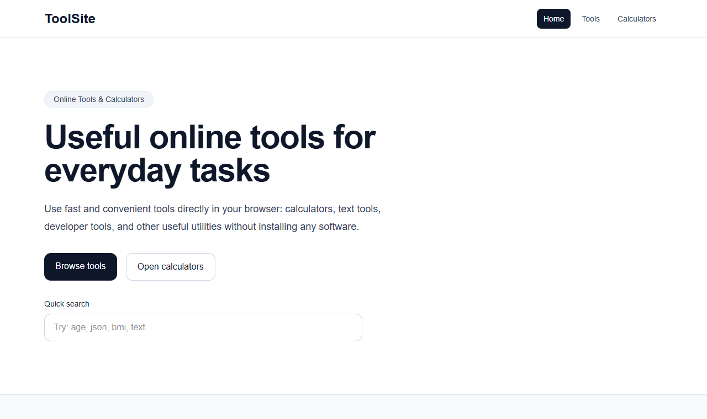

# ToolSite: free online tools and calculators

**Live:** [toolsite-pink.vercel.app](https://toolsite-pink.vercel.app)



A fast collection of everyday tools that run right in the browser, with no sign-up and nothing to install.

## What's inside

- **Calculators:** age, BMI, loan, percentage, percentage change, unit converter
- **Text tools:** word counter, character counter, case converter, text diff checker, text repeater, lorem ipsum generator, HTML to text
- **Developer tools:** JSON formatter and minifier, CSV to JSON, Base64 and URL encoder/decoder, UUID generator and validator, timestamp converter, slug generator, VAST tag tester
- **Utilities:** password generator and strength checker, QR code generator, color picker and converter, email and URL extractors and validators, random number generator

## Built with

- Next.js (App Router) and TypeScript
- One shared tool registry (`data/tools.ts`) that drives navigation, search and categories
- SEO basics: `sitemap.ts`, `robots.ts`, page metadata, privacy policy and terms pages
- Deployed on Vercel

## Run locally

```bash
npm install
npm run dev
```

Then open http://localhost:3000.

---
Made by TechLab. Need a website or web tool? [Hire me on Upwork](https://www.upwork.com/freelancers/~01b4f473f91da148f5).
